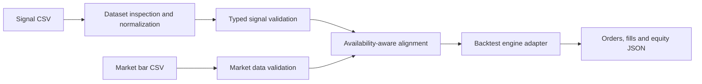

# Rust Backtest Platform

A Rust research platform that turns user-supplied signals and market bars into a deterministic replay and simulated execution result. The core design separates **research features** from **executable signals**, and **event time** from **when information became available**.

**Current state:** a file-based CLI execution path, typed validation/alignment crates, an in-memory API skeleton and a separate Python market-data collector. The HTTP backtest endpoint is still a placeholder; the CLI is the implemented execution entry point.

## Why this exists

A backtest should make the transition from a research dataset to a trade decision explicit. An arbitrary uploaded feature should not silently become an executable instruction, and a replay should not expose information before its availability time.

The workspace enforces contracts around signal intent, timestamps, instruments and market coverage before handing events to the simulation engine.



## Workspace map

| Package | Responsibility |
|---|---|
| [signal](crates/signal) | Executable signal types, finite-value checks, timestamp validation and duplicate detection |
| [dataset](crates/dataset) | CSV/Parquet handling, column-role inspection and signal normalization |
| [market-data](crates/market-data) | Instrument identity and validated market bars |
| [alignment](crates/alignment) | Replay ordering and market-coverage checks based on availability time |
| [engine-adapter](crates/engine-adapter) | Simulated execution and mark-to-market state |
| [analytics](crates/analytics) | Research analytics module |
| [api](crates/api) | Dataset inspection and placeholder job/result HTTP endpoints |
| [backtest-worker](apps/backtest-worker) | File-based execution CLI |
| [api-server](apps/api-server) | Local Axum server |
| [market-ingest](apps/market-ingest) | Separate Python S&P 500 research-data collector |

## Quick start

The workspace declares **Rust 1.85+** and edition 2024.

```bash
git clone https://github.com/arushg05/rustbacktest.git
cd rustbacktest
cargo test
```

### Run a small replay

Create `signals.csv`:

```csv
timestamp,symbol,signal
10,AAPL.XNAS,1
```

Create `bars.csv`:

```csv
timestamp,available_at,symbol,open,high,low,close,volume
9,9,AAPL.XNAS,100,101,99,100,1000
20,20,AAPL.XNAS,101,103,100,102,1100
```

The timestamps above are toy **integer nanosecond values**, not calendar dates or realistic trading data. The first bar provides coverage before the signal; the later bar allows the engine to process the resulting target.

```bash
cargo run -p backtest-worker -- --signals signals.csv --market bars.csv --output result.json
```

All three arguments are required. The current worker defaults to 100,000 initial cash and signal thresholds of +0.5 and -0.5. The JSON result exposes simulated orders, fills and final equity; inspect [the worker](apps/backtest-worker/src/main.rs) for the exact output shape.

## Signal and timing contracts

- A row needs a `signal` or `target_position`; arbitrary feature columns stay research context.
- Signal values must be finite, and instruments must have valid identifiers.
- Signals distinguish their event timestamp from `available_at`. If omitted, availability defaults to the event timestamp; the caller is responsible for whether that default is historically truthful.
- Duplicate instrument/event signals and invalid availability/expiry relationships are rejected.
- Replay ordering uses availability time. Bars precede signals at the same availability timestamp.
- A signal must have market data for the same instrument available at or before its decision time.

These checks make timing assumptions explicit. They cannot establish that an external dataset was actually known at the supplied timestamp.

## HTTP interface

```bash
cargo run -p api-server
```

The server binds to **http://127.0.0.1:3000**.

| Endpoint | Current behavior |
|---|---|
| `POST /datasets/inspect` | Inspects raw CSV request bytes and returns column roles, counts and warnings |
| `POST /backtests` | Creates a completed placeholder job with an empty result; does not run the CLI engine |
| `GET /backtests/{id}` | Retrieves that process's stored job/result or returns not found |

Jobs are held in memory. Restarting the server loses them. There is no production job queue, persistent API store or authentication layer in this skeleton.

## Separate S&P 500 data collection

[apps/market-ingest/update.py](apps/market-ingest/update.py) stores daily OHLCV, adjusted close, source/fetch timestamps and current S&P 500 constituent snapshots in SQLite.

```bash
python -m pip install -r apps/market-ingest/requirements.txt
python apps/market-ingest/update.py
```

Repeated runs upsert overlapping observations. The collector includes checkpoint/resume behavior for full-history downloads:

```bash
python apps/market-ingest/update.py --full-history --db data/sp500_full_history.sqlite
```

This cache is **not wired into the replay CLI**. An explicit conversion to market CSV and historically appropriate availability times is still needed. Current constituents are not a historical point-in-time universe; using them for past periods introduces survivorship concerns. Earliest downloaded observations are limited by the provider, not necessarily a company's first trading date.

The supplied PowerShell helper can support a local scheduled task, but cloning the repository does not install or enable a schedule on another machine.

## Checks

```bash
cargo fmt --check
cargo clippy --workspace --all-targets
cargo test
```

Tests cover contracts, replay ordering, missing data, execution scenarios, file parsing and API response shape. The API tests currently validate its placeholder behavior, not HTTP-to-engine execution. No throughput or latency benchmark is established by these checks.

NautilusTrader is a reference/integration target, not this project's source tree. The adapter's `nautilus` feature does not establish a complete external-engine integration; the public workspace contains no Nautilus dependency in that crate.

## Scope and next integration step

This is a bar-based research implementation, not an order-book simulator, a broker connection or evidence of microsecond execution. Its HTTP interface and market-data collector should not be mistaken for an integrated production platform.

The immediate integration step is to connect the HTTP run endpoint to the same validated signal/bar replay used by the CLI, preserving its timing contracts. See [development notes](docs/development.md) for the recorded implementation slices.

**Stack:** Rust, Cargo, Axum, Tokio, CSV/Parquet data handling, Python, SQLite.
